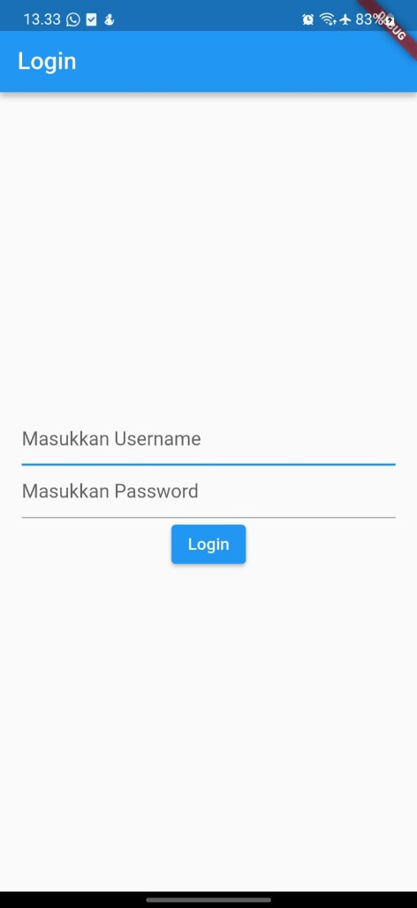
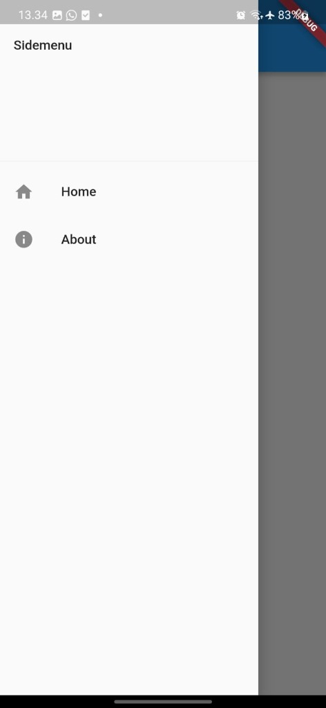
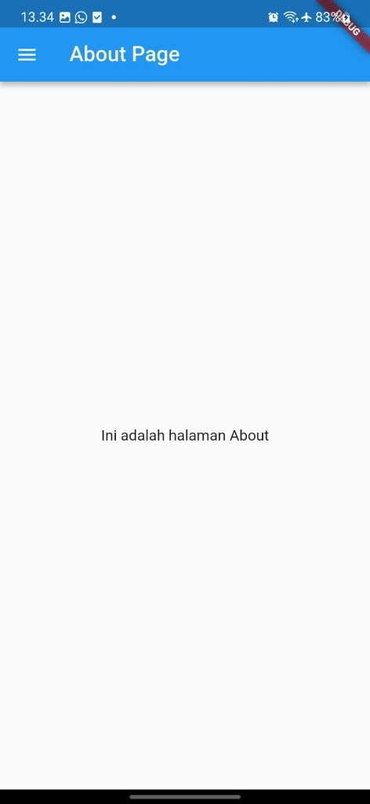
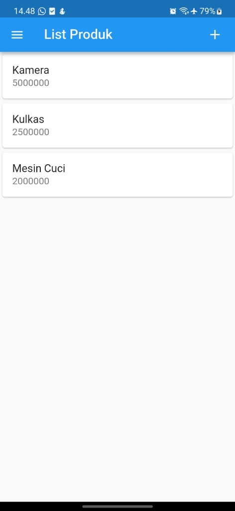
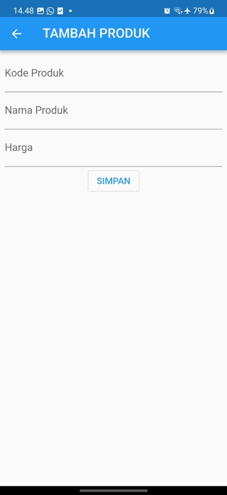
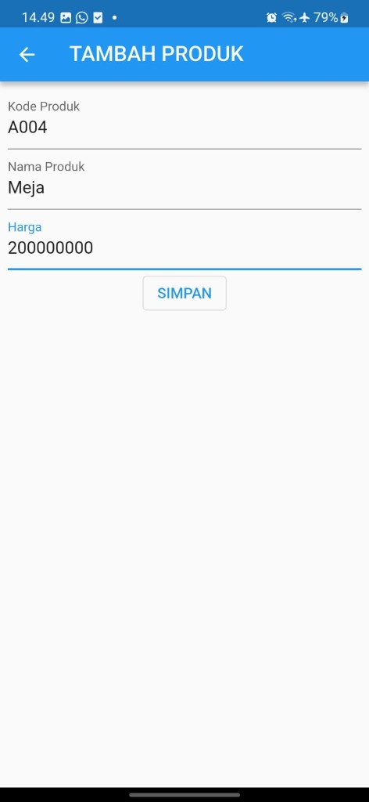
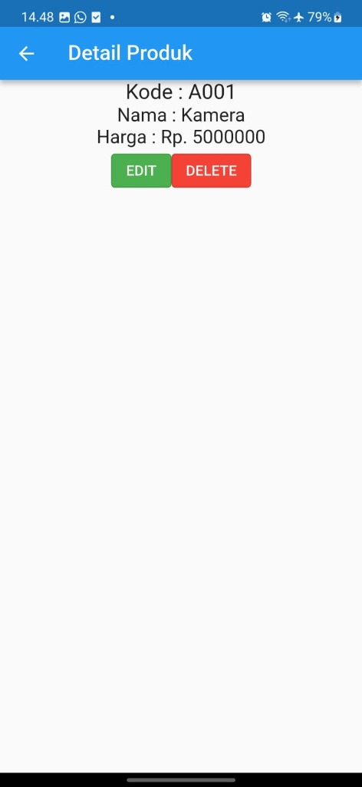
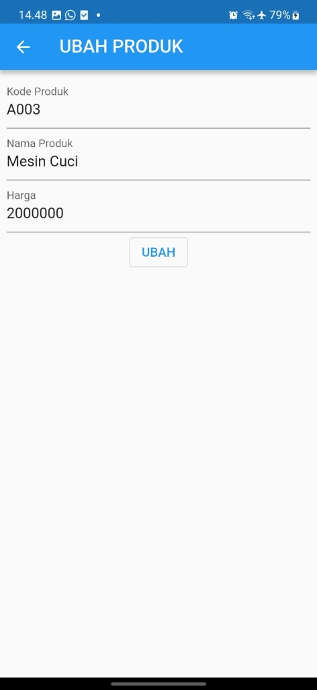

# Laporan Praktikum Pemrograman Mobile - Flutter

**Nama**: Edgina Syafa Ayu Wicaksono  
**NIM**: H1D024046  
**Shift**: Awal D / Akhir E  
**Praktikum**: Pemrograman Mobile

---

## 📝 Tugas Pertemuan 1: Instalasi Lingkungan Flutter & Dasar Bahasa Pemrograman Dart

**Tanggal**: Rabu, 21 Oktober 2026

### Deskripsi Teknis & Non-Teknis

- **Non-Teknis:** Kegiatan praktikum pertemuan pertama membahas persiapan perangkat lunak yang diperlukan untuk mengembangkan aplikasi menggunakan Flutter. Selain menyiapkan lingkungan pengembangan, praktikan mempelajari bahasa Dart sebagai bahasa pemrograman yang digunakan untuk menuliskan instruksi dan mengatur proses kerja aplikasi.

- **Teknis:**
1. Menginstal dan menyiapkan Flutter SDK, Android Studio, Android SDK, serta Java Development Kit (JDK).
2. Mengatur environment variable agar Flutter dapat diakses melalui terminal.
3. Mempelajari penggunaan variabel, tipe data, dan operator dalam Dart.
4. Mempraktikkan percabangan, perulangan, dan fungsi untuk menyusun alur program.
5. Mengenal penggunaan class dan object dalam pemrograman berorientasi objek (OOP).
6. Mempelajari penanganan kesalahan menggunakan try-catch serta proses asinkronus melalui async dan await

### Kesimpulan Pertemuan 1
Melalui praktikum ini, saya mempelajari cara menyiapkan perangkat pengembangan yang dibutuhkan untuk menjalankan Flutter serta mengenal bahasa Dart sebagai dasar penulisan kode aplikasi. Saya juga mempelajari penggunaan tipe data, fungsi, struktur kontrol, dan konsep pemrograman berorientasi objek. Materi tersebut membantu saya memahami tahapan awal pengembangan aplikasi mobile sebelum mempraktikkan pembuatan antarmuka menggunakan berbagai widget Flutter.

---

## 📝 Tugas Pertemuan 2: Widget & Design Flutter

**Tanggal**: Rabu, 28 Oktober 2026

### Hasil Praktikum

#### 1. Hello World

#### 2. Widget Column

#### 3. Widget Row

#### 4. Form Produk

#### 5. Detail Produk

#### 6. List Data Produk

### Deskripsi Teknis & Non-Teknis

- **Non-Teknis:** Pada pertemuan kedua, praktikum berfokus pada pengenalan framework Flutter dan pembuatan antarmuka aplikasi mobile. Praktikum meliputi pembuatan tampilan sederhana, penyusunan elemen secara vertikal dan horizontal, pengisian formulir produk, navigasi antarhalaman, serta penyajian data produk dalam bentuk daftar.

- **Teknis:**
1. Membuat tampilan aplikasi menggunakan widget dasar Flutter, seperti `MaterialApp`, `Scaffold`, `AppBar`, `Center`, dan `Text`.
2. Mengimplementasikan widget `Column` dan `Row` untuk mengatur tata letak elemen secara vertikal dan horizontal.
3. Membuat formulir input produk menggunakan `StatefulWidget`, `TextField`, dan `TextEditingController`.
4. Menggunakan `Navigator.push` dan `MaterialPageRoute` untuk melakukan navigasi dari halaman Form Produk ke halaman Detail Produk.
5. Menampilkan informasi produk menggunakan widget `Text`.
6. Membuat daftar produk menggunakan widget `ListView`, `Card`, dan `ListTile`.

### Kesimpulan Pertemuan 2

Praktikum pertemuan kedua memberikan pengalaman dalam membangun beberapa halaman aplikasi dengan fungsi yang berbeda. Saya mempelajari cara mengatur posisi elemen, menerima data melalui formulir, meneruskan informasi ke halaman detail, dan menyusun data produk dalam bentuk daftar. Melalui kegiatan ini, saya memahami bahwa setiap widget memiliki fungsi tersendiri dan dapat dikombinasikan untuk membangun tampilan aplikasi sesuai kebutuhan.

---

## 📝 Tugas Pertemuan 3: Routes, Side Menu, Login dan Local Storage

**Tanggal**: Rabu, 4 November 2026

### Hasil Praktikum

#### 1. Halaman Login

#### 2. Halaman Home

#### 3. Side Menu (Drawer)

#### 4. Halaman About

### Deskripsi Teknis & Non-Teknis

- **Non-Teknis:** Praktikum pertemuan ketiga membahas implementasi sistem autentikasi pengguna dan navigasi antarmuka melalui side menu (drawer). Praktikan mempelajari penyimpanan data lokal untuk sesi pengguna menggunakan Shared Preferences sehingga username yang diinputkan pada halaman login dapat ditampilkan kembali pada halaman utama aplikasi.

- **Teknis:**
1. Menambahkan dependensi `shared_preferences` pada `pubspec.yaml` untuk penyimpanan data lokal pengguna.
2. Membuat halaman `LoginPage` (`login_page.dart`) berbasis `StatefulWidget` dengan form input username dan password.
3. Mengimplementasikan fungsi `_saveUsername()` untuk menyimpan session username ke local storage via `SharedPreferences`.
4. Membuat custom alert dialog (`_showDialog()`) untuk memberikan notifikasi login sukses atau gagal beserta routing navigasi.
5. Membangun halaman `HomePage` (`home_page.dart`) dengan pemanggilan `_loadUsername()` untuk membaca data dari local storage.
6. Mengimplementasikan komponen `Drawer` (`sidemenu.dart`) yang berisi menu navigasi menuju halaman `HomePage` dan `AboutPage`.

### Kesimpulan Pertemuan 3

Melalui praktikum ketiga ini, saya mempelajari bagaimana mengelola alur autentikasi dan status login pengguna menggunakan media penyimpanan lokal (Local Storage) pada Flutter. Penggunaan routing dan side menu (drawer) mempermudah pengguna untuk berpindah antarhalaman secara terstruktur.

---

## 📝 Tugas Pertemuan 4: Operasi CRUD dengan API CodeIgniter 4 & Model-UI Flutter

**Tanggal**: Rabu, 11 November 2026

### Hasil Praktikum

#### 1. List Data Produk

#### 2. Form Tambah Produk (Kosong)

#### 3. Form Tambah Produk (Terisi)

#### 4. Detail Produk

#### 5. Form Ubah Produk

### Deskripsi Teknis & Non-Teknis

- **Non-Teknis:** Pada pertemuan keempat, praktikum berfokus pada pembangunan backend RESTful API menggunakan framework CodeIgniter 4 yang terhubung ke basis data MySQL (XAMPP), serta perancangan model data dan struktur antarmuka (UI) CRUD pada aplikasi Flutter Tokokita.

- **Teknis:**
1. Merancang basis data `toko_api` pada MySQL yang terdiri dari tabel `member`, `member_token`, dan `produk`.
2. Membangun backend RESTful API CodeIgniter 4:
   - `RestfulController.php`: Base controller penyedia format JSON dan helper `responseHasil()`.
   - `MRegistrasi.php` & `RegistrasiController.php`: Endpoint pendaftaran pengguna baru via method POST (`/registrasi`).
   - `MMember.php`, `MLogin.php` & `LoginController.php`: Endpoint autentikasi login via method POST (`/login`) dengan token otorisasi.
   - `MProduk.php` & `ProdukController.php`: Endpoint operasi CRUD produk (Create, Read/List, Detail, Update, Delete) melalui method POST, GET, PUT, dan DELETE.
   - Mengonfigurasi `Routes.php` untuk routing REST API.
3. Membangun Model Data pada Flutter (`lib/model/`):
   - `login.dart`: Representasi data login pengguna beserta token otentikasi.
   - `registrasi.dart`: Representasi status respon registrasi.
   - `produk.dart`: Representasi entitas data produk (`id`, `kodeProduk`, `namaProduk`, `hargaProduk`) dilengkapi factory `fromJson`.
4. Membangun Halaman Antarmuka Flutter (`lib/ui/`):
   - `registrasi_page.dart`: Form registrasi dengan validasi nama (min 3 karakter), format email (regex), password (min 6 karakter), dan konfirmasi password.
   - `login_page.dart`: Form login dengan validasi dan navigasi tautan menuju form registrasi.
   - `produk_page.dart`: Menampilkan daftar produk (`ListView`, `Card`, `ListTile`) dengan data dummy produk, aksi navigasi penambahan produk (`+`), serta drawer logout.
   - `produk_form.dart`: Form fleksibel yang menangani operasi tambah produk (`TAMBAH PRODUK` / `SIMPAN`) dan ubah produk (`UBAH PRODUK` / `UBAH`).
   - `produk_detail.dart`: Menampilkan informasi detail produk dengan tombol aksi ubah (`EDIT` berwarna hijau) dan konfirmasi dialog hapus (`DELETE` berwarna merah).
5. Mengonfigurasi tema aplikasi pada `lib/main.dart` dengan tema Material 2 biru (`primarySwatch: Colors.blue`, `useMaterial3: false`) agar tampilan visual, warna AppBar, dan elemen tombol presisi sesuai dengan modul praktikum.

### Kesimpulan Pertemuan 4

Praktikum pertemuan keempat memberikan pemahaman komprehensif mengenai konsep arsitektur RESTful API, perancangan skema database MySQL, serta pembuatan struktur model dan antarmuka aplikasi mobile pada Flutter. Struktur kode yang terpisah secara modular antara model dan UI memudahkan pemeliharaan kode dan persiapan integrasi data secara langsung ke server API.

